# SAP BDC data product

Publishes the tables of the Databricks import ([../README.md](../README.md)) as a data product to SAP
Business Data Cloud, consumable in SAP Datasphere.

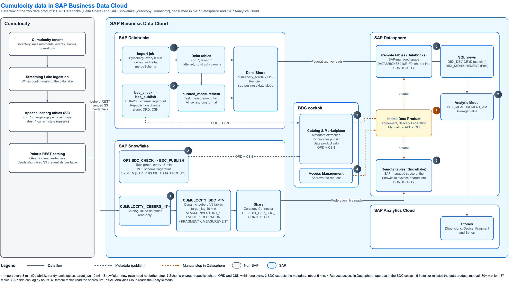

Data flow of both data products; editable source: [img/sap-bdc-data-flow.drawio](img/sap-bdc-data-flow.drawio).

| File | Purpose |
|---|---|
| `bdc_connect.py` | Creates a Delta Share from the import tables and publishes it as a data product to SAP Business Data Cloud |
| `bdc_tables.py` | Table selection and schema fingerprint of the data product (a workspace file imported by `bdc_connect` and `CheckBdcSchema`) |
| `CheckBdcSchema.py` | Decides whether the data product needs a republish (task `bdc_check`) |
| `RefreshMeasurementFact.py` | Rebuilds `curated_measurement`, all measurement series in long format |
| `bdc_delete.py` | Removes the data product from BDC and drops the Delta Share |

## Contents and naming

`bdc_connect` shares everything the import writes for the tenant in the Delta Share `cumulocity_t2180777119`,
grants it to the recipient `sap-business-data-cloud`, and publishes it to SAP Business Data Cloud with
ORD metadata and a CSN schema generated from the tables:

| In the share | Source | Content |
|---|---|---|
| `cdc_<namespace>.cdc_<namespace>_<table>` | every `cdc_*` table | Change log per Iceberg table: alarms, events, inventory, one table per measurement fragment |
| `latest_<namespace>.latest_<namespace>_<table>` | every `latest_*` table | Current state per object (inventory) |
| `curated.curated_measurement` | `curated_measurement` | Every measurement series in long format: `id, fragment, series, time, source, value, unit`, key `(id, fragment, series)`. The fact for analytic models |

New Iceberg tables join automatically (`bdc_tables.share_tables`); helper tables (`_*`, `grafana_*`,
`internal_*`) are left out. Inside the share each table keeps its full Databricks name: Datasphere names the
remote tables `<share>:v1.<table>` without the schema, and with short names `cdc_inventory.c8y_agent` and
`latest_inventory.c8y_agent` collided, so the install dropped all 18 `latest_inventory` tables (tested
2026-11-06: 119 of 137 tables deployed). The task `measurement_fact` rebuilds `curated_measurement` after every import
(`RefreshMeasurementFact`); it discovers the `<series>_value` columns on each run.

Two adjustments make the tables installable in Datasphere: the CSN declares timestamps as `cds.Timestamp`
(the SDK generates `cds.DateTime`, which Datasphere rejects with `MISMATCH IN DATA TYPE`), and the import
writes no `struct` columns, which the CSN can't express. It needs `CREATE SHARE` and `USE RECIPIENT` on
the metastore (granted by the BDC operators) and the `sap-bdc-connect-sdk` secret scope with `api_url`,
`tenant` and `token_audience`.

**Republish on schema change.** Three tasks in the import job keep the data product in step with the
tables:

| Task | Does |
|---|---|
| `bdc_check` | After `import` and `measurement_fact` succeed, computes a SHA-256 fingerprint over the selected tables, their names in the share, columns, types and nullability, and compares it with the last publish (`_bdc_publish_state`). Sets the task value `changed`. Takes seconds, installs nothing. |
| `bdc_changed` | Condition: `{{tasks.bdc_check.values.changed}} == "true"`. |
| `bdc_publish` | Runs `bdc_connect` (share contents, ORD, CSN, publish) and stores the new fingerprint. |

So a new measurement column (the import appends with `mergeSchema`), a changed type, or a new Iceberg
table republishes the data product within one import cycle; otherwise nothing runs. To
force a republish, delete the share's rows from `_bdc_publish_state` or run `bdc_connect` by hand.
Import the notebooks from this folder into the workspace and upload `bdc_tables.py` as a workspace file next to them.

`bdc_connect` also removes share tables whose source table no longer matches the selection, which
removes them from the data product; consumers in Datasphere that use them break.

## Step by step: from Databricks to Datasphere

**Once, by the platform admins**
- Databricks metastore: `CREATE SHARE` for you (workspace admins have it) and `USE RECIPIENT` on
  `sap-business-data-cloud` (only the BDC operators can grant it).
- Secret scope `sap-bdc-connect-sdk` with `api_url`, `tenant` and `token_audience`.
- Datasphere: a space for the data (here `CUMULOCITY`) with you as a member who may install data products,
  and Datasphere enabled as a target for data products from the SAP Databricks system.
- BDC: the approver role for the domain (*Governance → Access Management* shows the requests).

**1. Databricks: publish**
1. Import this folder into the workspace folder of the import notebook: `bdc_connect`, `CheckBdcSchema`,
   `RefreshMeasurementFact`, `bdc_delete` as notebooks, `bdc_tables.py` as a file.
2. Import job: add the task `measurement_fact` (notebook `RefreshMeasurementFact`, depends on `import`,
   *Run if* **All done**) and run the job once, so `curated_measurement` exists.
3. Decide the table names now: renaming or removing tables after the first install is a breaking change (see
   below).
4. Run `bdc_connect`. The output lists every table (`source -> schema.table`), then `Share registered.`,
   `CSN uploaded.` and `Data product '...' published`.
5. Automatic republish: add the tasks `bdc_check` (notebook `CheckBdcSchema`, depends on `import` and
   `measurement_fact`), `bdc_changed` (condition task) and `bdc_publish` (notebook `bdc_connect`, depends on
   `bdc_changed` = true). Set up in the import job since 2026-11-06.

**2. BDC: wait for the catalog**
1. BDC cockpit, *Catalog & Marketplace → Metadata Extractions*: wait until `databricks-6918e1f0` shows
   *Synchronized* with *Last Synchronized* **after** your publish. The catalog shows what the last extraction
   read, not what you just published.
2. *Catalog & Marketplace → Search → Data Products*: open the product and check the description and
   *APIs* (functional status *Current*).

**3. Datasphere: request, approve, install**
1. In **Datasphere** (not the BDC cockpit, whose cart doesn't offer Datasphere): *Catalog & Marketplace →
   Search → Data Products*, find the product, *Add to Cart*, open the cart, *Proceed*.
2. *Request Access*: space `CUMULOCITY`, a comment, no end date, accept the terms, *Send*.
3. BDC cockpit, *Governance → Access Management*: open the request and *Approve*.
4. Datasphere, *Catalog & Marketplace → Data Product Access → Agreements*: open the agreement (status
   *Current*), *Install Data Product*, delivery method **Federation** (queries read the Delta tables live;
   Replication copies them), *Install*.
5. Watch the notifications (bell): *Data Product Installation: Completed* with *Saved objects* equal to
   *Deployed objects*. With *Failed*, *Show More* lists the table and column; deployment is all or nothing.
6. *Data Builder →* space `CUMULOCITY`: every table is a *Remote Table*, status *Deployed*. Open one,
   *Data Viewer*, and compare the row count with Databricks.

## Analytic Model for SAP Analytics Cloud

SAP Analytics Cloud reads Analytic Models, not remote tables. Space `CUMULOCITY` has one on
`curated_measurement`, built in the Data Builder on 2026-11-09:

| Object | Type | Content |
|---|---|---|
| `DBX_DEVICE` *Device (Databricks)* | SQL view, Dimension | `latest_inventory_inventory`: `ID` (key, text `NAME`), `NAME`, `TYPE`, site and asset attributes |
| `DBX_MEASUREMENT` *Measurement (Databricks)* | SQL view, Fact | `curated_measurement` plus `FRAGMENT_SERIES` and `DAY`; association `SOURCE` → `DBX_DEVICE.ID` |
| `DBX_MEASUREMENT_AM` *Measurements (Databricks)* | Analytic Model | Fact `DBX_MEASUREMENT`, dimension Device, calculated Average Value |

All three are in Datasphere *Data Builder →* space `CUMULOCITY`. Each step ends with *Deploy*: the
first deploy asks for the name in a *Save* dialog; if the status still says *Not Deployed* afterwards,
click *Deploy* again.

**1. Find the source tables.** Search the Data Builder for `curated`: the Databricks tables are remote
tables in the SAP-managed space `DATABRICKS6918E1F0`, shared into `CUMULOCITY`. No reinstall is needed
as long as `curated_measurement` shows *Deployed*.

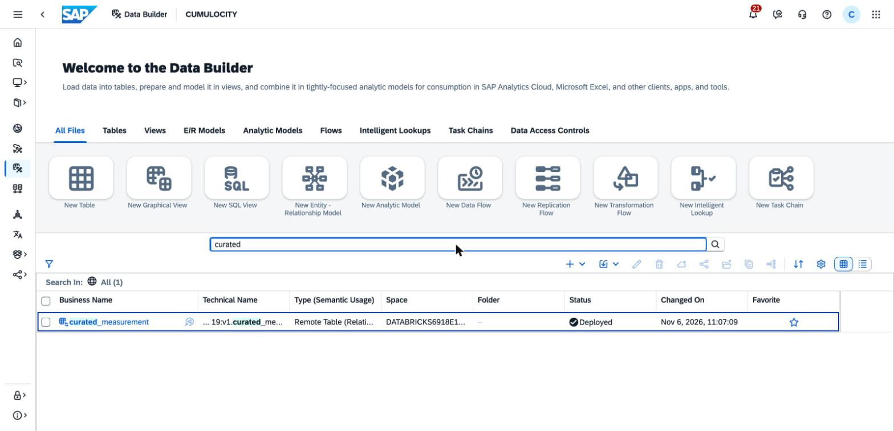

**2. Device dimension `DBX_DEVICE`.** *New SQL View*. Dragging a table from the *Repository* panel into
the editor inserts its full name, `"DATABRICKS6918E1F0.cumulocity_t2180777119:v1.<table>"`.

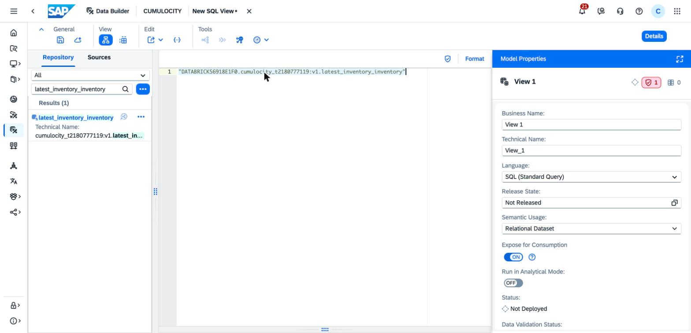

Enter the SQL, set *Business Name* `Device (Databricks)`, *Technical Name* `DBX_DEVICE`, *Semantic
Usage* **Dimension**, then *Validate SQL* (shield icon above the editor):

```sql
SELECT "id" AS "ID", "name" AS "NAME", "type" AS "TYPE", "site_code" AS "SITE_CODE",
       "site_type" AS "SITE_TYPE", "operating_region" AS "OPERATING_REGION", "catchment" AS "CATCHMENT",
       "process_stage" AS "PROCESS_STAGE", "asset_criticality" AS "ASSET_CRITICALITY",
       "operational_status" AS "OPERATIONAL_STATUS"
FROM "DATABRICKS6918E1F0.cumulocity_t2180777119:v1.latest_inventory_inventory"
WHERE "id" IS NOT NULL
```

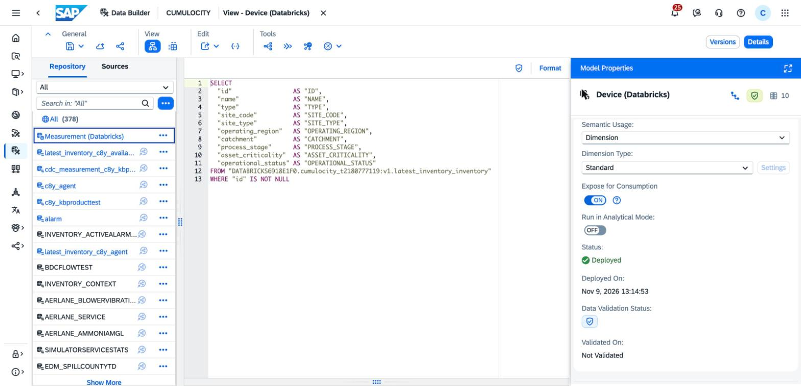

In *Attributes → Edit* (pencil): tick `ID` as key, rename `ID` / `NAME` to *Device ID* / *Device
Name*, set `NAME` to semantic type **Text** and `ID`'s *Text / Association* to *Device Name*, so SAC
shows names instead of IDs. *Deploy*.

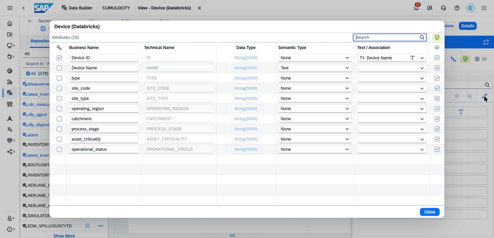

**3. Measurement fact `DBX_MEASUREMENT`.** *New SQL View*, *Business Name* `Measurement (Databricks)`,
*Technical Name* `DBX_MEASUREMENT`, *Semantic Usage* **Fact**:

```sql
SELECT "id" AS "ID", "fragment" AS "FRAGMENT", "series" AS "SERIES",
       "fragment" || '.' || "series" AS "FRAGMENT_SERIES", "time" AS "TIME", TO_DATE("time") AS "DAY",
       "source" AS "SOURCE", "unit" AS "UNIT", "value" AS "VALUE", "value" AS "VALUE_MIN",
       "value" AS "VALUE_MAX", 1 AS "SAMPLES"
FROM "DATABRICKS6918E1F0.cumulocity_t2180777119:v1.curated_measurement"
```

`VALUE` appears three times because a measure has one aggregation; `SAMPLES` counts rows and gives the
average in the Analytic Model. `FRAGMENT_SERIES` is a single filter for one series, since series names
repeat across fragments (`health_score` is in six).

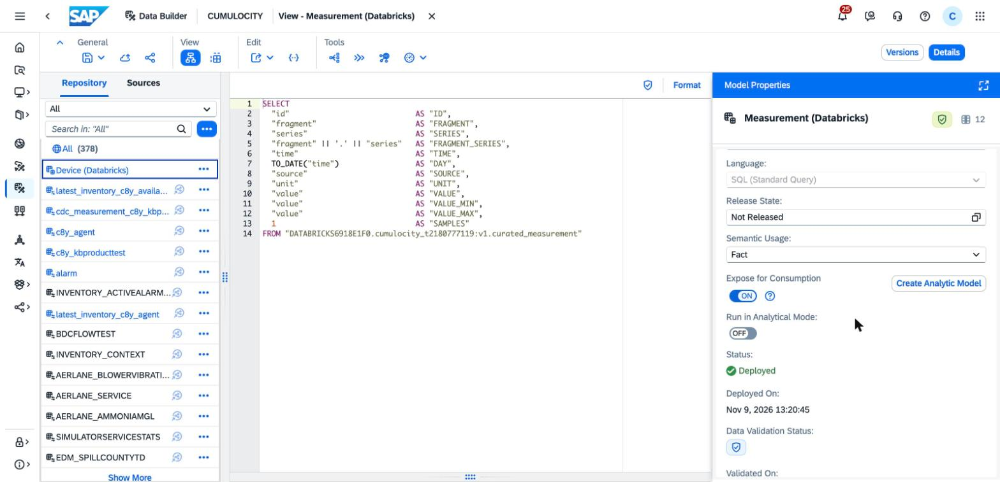

In *Attributes → Edit*: business names as below, `UNIT` semantic type **Unit of Measure**. The key
(`ID`, `FRAGMENT`, `SERIES`) comes from the source table.

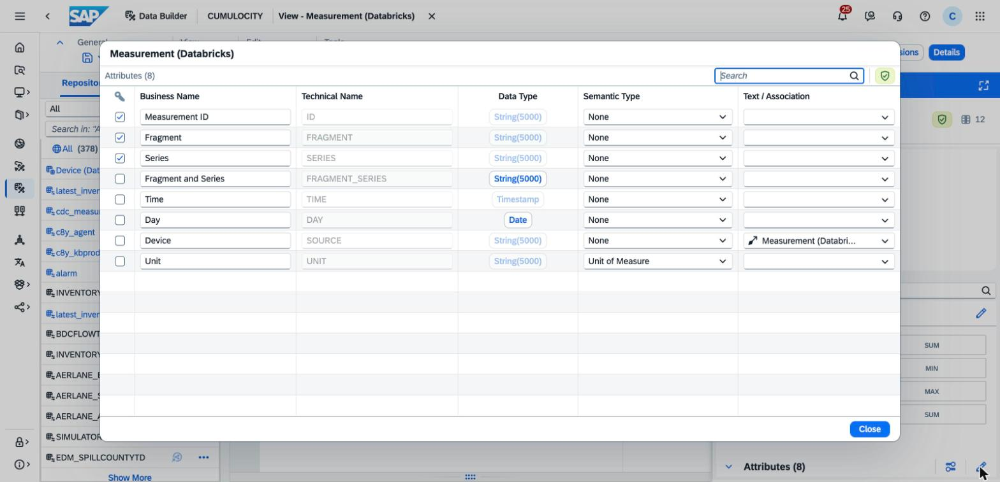

For `VALUE`, `VALUE_MIN`, `VALUE_MAX` and `SAMPLES`: *⋯ → Change to Measure*. Then *Measures → Edit*:
aggregation SUM / MIN / MAX / SUM, the three value measures *Quantity with Unit* with *Unit Column*
`Unit`.

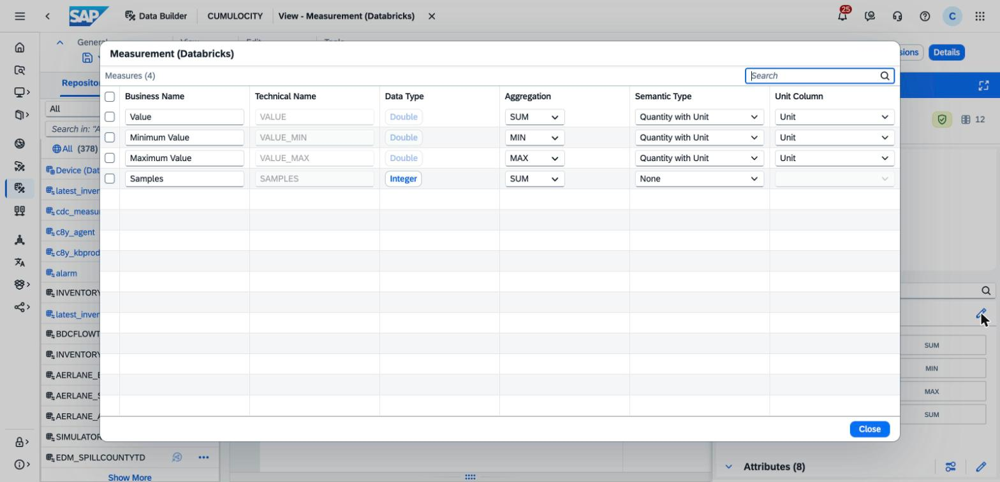

*Associations → + → Association*, target `DBX_DEVICE`. Datasphere maps the key columns by itself
(`ID` → `Device ID`), which is wrong here: delete that line and drag *Device* (`SOURCE`) onto *Device
ID*. *Deploy*.

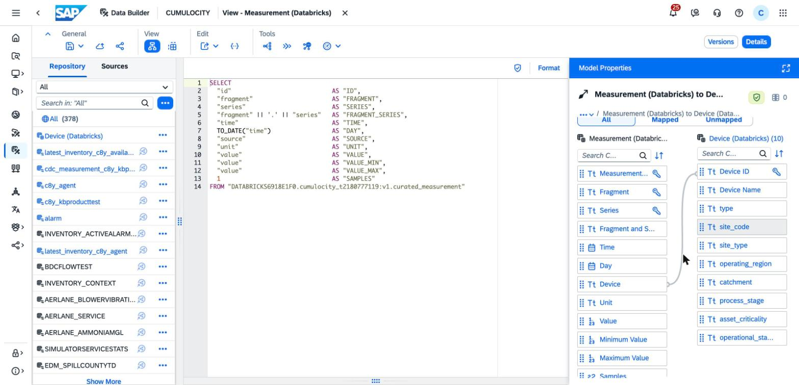

**4. Analytic Model `DBX_MEASUREMENT_AM`.** In `DBX_MEASUREMENT`, *Create Analytic Model*: it takes the
fact with all measures and attributes and adds *Device* as a dimension through the association. Set
*Name* `Measurements (Databricks)`, *Technical Name* `DBX_MEASUREMENT_AM`.

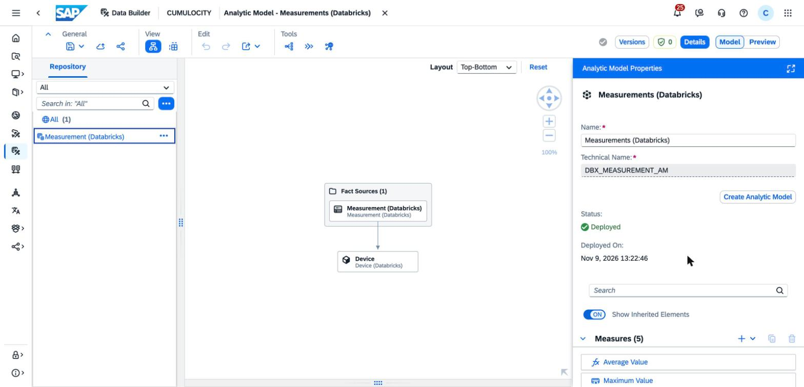

*Measures → + → Calculated Measure*: *Average Value*, expression `VALUE / SAMPLES`, *Validate*.
(Datasphere derives the technical name `Average_Value` from the business name.) *Deploy*.

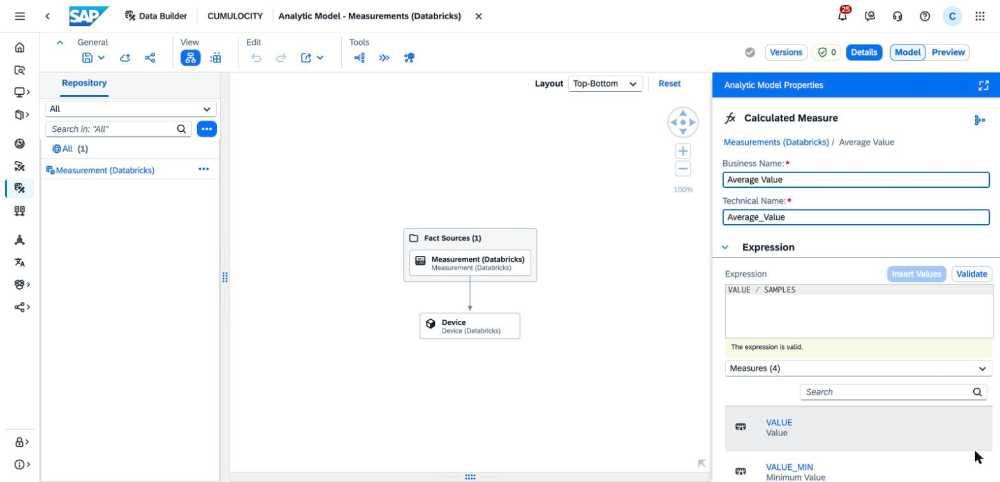

**5. Check.** *Preview*, add *Fragment and Series* to *Rows*. Without a series in rows or filter, the
value measures show `•`: they mix units. On 2026-11-09 the preview read all 14.65 million rows live
from the Delta Share (Federation) in about 15 seconds, for example `air_flow_nm3h`: 125,282 samples,
min 142.47, max 9,031.81, average 5,402.9 Nm³/h.

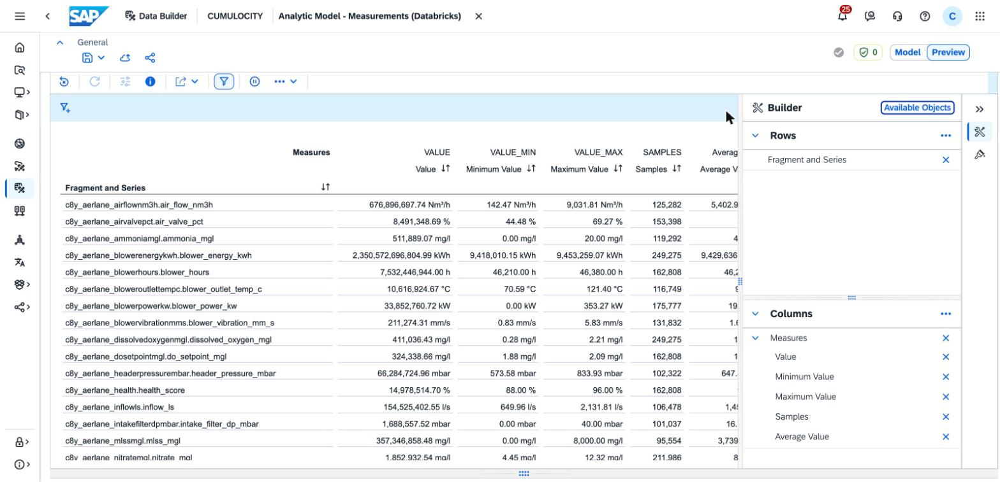

In SAC, *Fragment and Series* takes the place of the Grafana `series` variable and *Device* of
`device`.

## From an Iceberg change to Datasphere

| # | Step | How | Time |
|---|---|---|---|
| 1 | Lake → Delta tables | Import job copies Iceberg to Delta every 8 minutes (`mergeSchema` for new columns) | ≤ 8 min |
| 2 | `bdc_check` → `bdc_changed` | Same job; compares a SHA-256 fingerprint with `_bdc_publish_state` | seconds |
| 3 | `bdc_publish` | Updates the Delta Share, ORD and CSN, then publishes | ~1 min |
| 4 | BDC metadata extraction | Starts by itself after the publish | ~5 min |
| 5 | Datasphere: *Check for Schema Changes* or *Reinstall Data Product* | **Manual**, no API | 30+ min for 137 tables (2026-11-06) |
| | New rows only | Import every 8 minutes; Federation reads the share live | ≤ 8 min, no steps 2–5 |

Steps 1 to 4 take about 15 minutes. The delays and failures are in step 5, on SAP's side:

- **Manual.** Datasphere has no API or CLI for the install step (see below).
- **SAP's side lags behind BDC, sometimes by hours.** The new product stayed *Entitlement: Invalid* from
  2026-11-05 until the next morning, while BDC's extraction runs hung. A reinstall right after a rename
  deployed the old definition. Nothing on our side shows or triggers this; wait and retry.
- **Installed tables are rigid.** Renamed tables leave orphaned remote tables that only SAP support
  removes. With the Snowflake product, a reinstall also couldn't change a column's type ("MISMATCH IN DATA
  TYPE PRECISION/SCALE"); keep column types stable here too.
- **All or nothing.** One failing table fails the whole reinstall.

The Snowflake data product goes through the same Datasphere step: [../../snowflake/sap-bdc/README.md](../../snowflake/sap-bdc/README.md).

**Changing the data product later: what runs automatically and what is manual**

| Change | Databricks | BDC catalog | Datasphere |
|---|---|---|---|
| New rows in existing tables | Automatic: `import` every 8 minutes | Nothing to do | Nothing to do: Federation reads the share live |
| New table (new fragment or Iceberg table), new column, changed type | Automatic: `import` creates or alters the table, `bdc_check` sees the new fingerprint, `bdc_publish` republishes | Automatic: the publish starts a metadata extraction (about 5 minutes) | **Manual**: *Data Product Access → Agreements →* the agreement *→ Check for Schema Changes* or *⋯ → Reinstall Data Product* |
| Renamed or removed table | Automatic, same as above; renames come from `bdc_tables.py` changes, which you deploy | Automatic | **Manual** reinstall, as above; the old remote tables stay in the SAP-managed space (only SAP support removes them) |

Datasphere has no API or CLI command for installing, reinstalling or updating a BDC data product (checked
2026-11-06): the `datasphere` CLI covers spaces, modeling objects, tasks, users and the Data Marketplace, not
BDC agreements. The Datasphere step stays a click.

Notes on the manual step:
- Wait until *Metadata Extractions* shows `databricks-6918e1f0` *Synchronized* with a time after the publish
  (the `bdc_publish` task's end time). An earlier reinstall right after a rename deployed the old definition.
- A reinstall of 137 tables took over 30 minutes on 2026-11-06 and showed only *Data Product Installation:
  Started* until it finished; no progress appears anywhere. Wait for *Completed* (saved objects equal to
  deployed objects) before trying anything else.
- After a rename, the reinstall adds remote tables under the new names and leaves the old ones in the space;
  they point at tables that are gone and can't be deleted from Datasphere.
- BDC Connect takes only `title`, `shortDescription` and `description` from the ORD document. It sets the
  ORD ID (`sap.databricks:dataProduct:<share>:v1`) and version 1.0.0 itself and ignores `ordId` or `version`
  sent with the share. A new major version is not possible; a new `share_name` gives a separate data product.

**Removing everything**
1. Remove the `bdc_*` tasks from the import job, or the next schema change publishes again.
2. Datasphere, *Data Product Access → Agreements →* the agreement *→ End Agreement* (uninstalls it).
3. Run `bdc_delete`: deletes the share and data product in BDC, then drops the Delta Share and the
   share's rows in `_bdc_publish_state`. The catalog entry disappears with the next metadata extraction.
