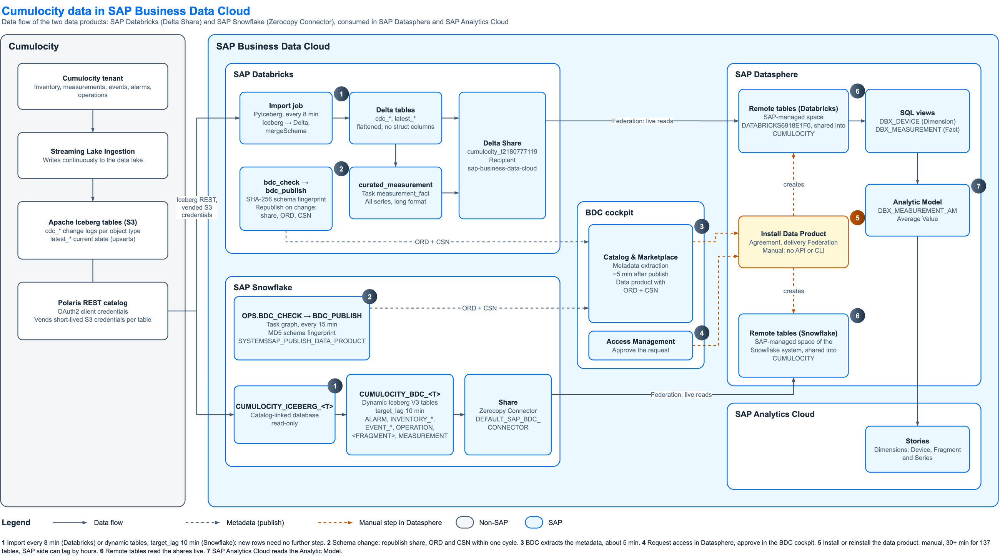

# SAP BDC data product (Snowflake)

`cumulocity_bdc_data_product.ipynb` publishes the Cumulocity data of one tenant to SAP Business Data Cloud
(BDC) through the native SAP Snowflake mechanism: a Snowflake share on the BDC Zerocopy Connector, with ORD
and CSN passed to `SYSTEM$SAP_PUBLISH_DATA_PRODUCT`. Content matches the Databricks product
([../../databricks/sap-bdc/README.md](../../databricks/sap-bdc/README.md)).

| File | Purpose |
|---|---|
| `cumulocity_bdc_data_product.ipynb` | Creates the tables, share, procedures and task graph, and publishes |
| `cumulocity_bdc_tear_down.ipynb` | Removes the data product |

## Databases

The data product uses three databases per tenant (`<T>` = tenant ID). Only the last one is shared with BDC.

| Database | Created by | Contains | Role |
|---|---|---|---|
| `CUMULOCITY_ICEBERG_<T>` | `../cumulocity_build_up.ipynb` | The Cumulocity Iceberg tables (`cdc_*`, `latest_*`), linked to the Polaris catalog. Read-only; the data stays in Cumulocity's S3 storage | Source of every shared table |
| `CUMULOCITY_<T>` | `../cumulocity_build_up.ipynb`, extended by `cumulocity_bdc_data_product.ipynb` | `CURATED`: dynamic tables for users and Grafana. `OPS`: the build-up's schema-change task, alert and `SCHEMA_STATE`, plus the procedures `BDC_CREATE_TABLES`, `BDC_CHECK`, `BDC_CSN`, `BDC_PUBLISH`, the tasks `BDC_CHECK`, `BDC_PUBLISH` and the publish log `BDC_STATE` | Builds and publishes the data product; not shared |
| `CUMULOCITY_BDC_<T>` | `cumulocity_bdc_data_product.ipynb` | Schema `CUMULOCITY` with the shared tables below, nothing else. Snowflake-managed Iceberg V3 (copy-on-write, `COMPATIBLE` serialization), set on the database so every table inherits it; the data is stored in Snowflake | The data product: granted to the share on the Zerocopy Connector |

BDC needs a database of its own: one database per data product, and the connector accepts only
Snowflake-managed Iceberg V3 tables with a primary key. The linked Iceberg tables in `CUMULOCITY_ICEBERG_<T>`
don't qualify, so the shared tables copy them as dynamic tables.

## Tables

All in `CUMULOCITY_BDC_<T>.CUMULOCITY`, dynamic Iceberg tables refreshed within `target_lag` (10 minutes):

| Table | Source | One row per | Key |
|---|---|---|---|
| `ALARM`, `OPERATION` | `cdc_alarm`, `cdc_operation` | object, current state | `ID` |
| `INVENTORY` | `cdc_inventory."inventory"` | managed object, current state, deleted ones excluded | `ID` |
| `INVENTORY_<FRAGMENT>` | other `cdc_inventory` tables | managed object with that fragment | `ID` |
| `EVENT`, `EVENT_<FRAGMENT>` | `cdc_event` tables | event | `ID` |
| `<FRAGMENT>`, e.g. `SEWPUMP_WINDINGTEMPC` | `cdc_measurement` tables matching `measurement_tables` (default `%`) | measurement, one column per series plus `<SERIES>_UNIT` | `ID` |
| `MEASUREMENT_SERIES` | the same measurement tables | measurement and series, long format: `ID, FRAGMENT, SERIES, TIME, SOURCE, VALUE, UNIT` | `ID, FRAGMENT, SERIES` |

- Join `SOURCE` to `INVENTORY.ID`. `MEASUREMENT_SERIES` is the fact for an Analytic Model.
- Not shared: `cdc_rejected`, `internal`, and `latest_*` (Snowflake can't read equality deletes; the
  `INVENTORY*` tables carry the same current state).
- Current state = the latest row per `ID` by `lastUpdated`, then the newest other timestamp column. Cumulocity
  updates some fragments without changing `lastUpdated`.
- `INVENTORY_ACTIVEALARMSSTATUS` counts the uncleared alarms per severity from the alarm change log, because
  its change rows tie on every timestamp.
- Names: upper snake case, `c8y_` dropped, repeated underscores collapsed (`ID__0` broke the BDC metadata
  extraction). Arrays and objects are JSON text, timestamps UTC. Two sources that map to one name stop the
  build.
- Over 100 tables refresh on the tenant's warehouse. Raise `target_lag` or narrow `measurement_tables`
  (e.g. `c8y_SewPump%`) to save credits.

**Keep column types stable.** A Datasphere reinstall can't change the type of an installed column. Numbers
stay as in the source (counts are `NUMBER(38,9)`) and the CSN declares them as `cds.Decimal(p, s)`. Moving
the counts to other types took four failed attempts and was reverted.

**Don't reuse a table name with other columns.** SAP keeps the first schema it saw for a shared table name.
The long table was called `MEASUREMENT` on Oct 29 with other columns; the Nov 9 version under the same name
failed the reinstall with "COLUMN IS MISSING IN REMOTE DATA SOURCE" for `ID` and `SOURCE`, so it is now
`MEASUREMENT_SERIES`.

## Setup

Needs an SAP Snowflake account (or a Snowflake account connected through SAP BDC Connect for Snowflake) in a
BDC formation; not available on trial accounts.

1. Run [`../cumulocity_build_up.ipynb`](../cumulocity_build_up.ipynb) for the tenant.
2. `SHOW ZEROCOPY CONNECTORS IN ACCOUNT`: `CONNECTORS.ZEROCOPY.DEFAULT_SAP_BDC_CONNECTOR` must be
   `CONNECTED` (SAP creates it when the system joins the formation).
3. In `cumulocity_bdc_data_product.ipynb`, set `catalog_name`, `share_name` and the ORD texts, then run
   sections 1 to 4: database, share, tables, procedures. Nothing changes in BDC yet; `bdc_csn_preview` shows
   the CSN.
4. Section 5 enables share-back, adds the share to the connector and publishes. The product appears in the
   BDC catalog after the metadata extraction (a few minutes).
5. Sections 6 (task graph) and 7 (checks).

## Republish on schema change

| Task | Runs | Does |
|---|---|---|
| `OPS.REBUILD_ON_SCHEMA_CHANGE` | every 15 min (root, from the build-up) | Rebuilds `CURATED` |
| `OPS.BDC_CHECK` | after the root | On source column changes runs `BDC_CREATE_TABLES`; compares an MD5 fingerprint of the shared schema with the last publish, returns `changed` / `unchanged` |
| `OPS.BDC_PUBLISH` | after `BDC_CHECK`, when `changed` | Generates the CSN, publishes, stores the fingerprint in `OPS.BDC_STATE` |

- `BDC_CREATE_TABLES` replaces only tables whose definition changed (an MD5 tag in the table comment).
  Every replaced table is new to Datasphere and delays the reinstall.
- Force a republish: `CALL CUMULOCITY_<T>.OPS.BDC_PUBLISH()`. BDC accepts it under version 1.0.0.
- Both procedures run with caller's rights: `SYSTEM$SAP_PUBLISH_DATA_PRODUCT` and `SYSTEM$SET_RETURN_VALUE`
  are refused with owner's rights.

## Install in Datasphere

| Install in | Snowflake product | Databricks product |
|---|---|---|
| SAP Datasphere | yes, request in Datasphere | yes, request in Datasphere |
| SAP Databricks | yes, BDC cockpit cart | — |
| SAP Snowflake | — | no |

Datasphere steps: as for Databricks ([Install in
Datasphere](../../databricks/sap-bdc/README.md#install-in-datasphere)), with source system
`snowflake-7df47c68`. The tables land in the SAP-managed space `SNOWFLAKE7DF47C68` as
`cumulocity_adhoc_demo:v1.<TABLE>`. They can't be opened from `CUMULOCITY`; to check data, query
`"SNOWFLAKE7DF47C68.cumulocity_adhoc_demo:v1.<TABLE>"` in a *New SQL View* and discard it.

A first install of 21 tables took about 7 minutes, a reinstall of 120 tables 6 to 9 minutes.

## From an Iceberg change to Datasphere

| # | Step | Time |
|---|---|---|
| 1 | Lake → catalog-linked `CUMULOCITY_ICEBERG_<T>` | ~2 min |
| 2 | `REBUILD_ON_SCHEMA_CHANGE` → `BDC_CHECK` → `BDC_CREATE_TABLES` | 0–15 min + ~1 min |
| 3 | `BDC_PUBLISH` | ~1 min |
| 4 | BDC metadata extraction | ~1 min |
| 5 | Datasphere *Reinstall Data Product*, **manual** | 6–9 min, when the SAP side has caught up |
| | New rows only: dynamic tables plus Federation | ≤ 10 min, no steps 2–5 |

Steps 1 to 4 took under 7 minutes for a new fragment. *Check for Schema Changes* doesn't add new tables.

If a reinstall fails with "Remote object ... could not be found" or deploys the old definition, the SAP side
hasn't picked up the added or replaced tables yet: retry a few hours later (it worked the next morning).
Other limits: [Known issues on the SAP side](../../databricks/sap-bdc/README.md#known-issues-on-the-sap-side).

## Removing the data product

1. Datasphere, *Data Product Access → Agreements →* the agreement *→ End Agreement*.
2. Run `cumulocity_bdc_tear_down.ipynb`: drops the `BDC_*` tasks, procedures and `BDC_STATE`, removes the
   share from the connector, drops the share and `CUMULOCITY_BDC_<T>`. `CURATED` keeps updating. The BDC
   catalog entry may remain (SAP documents no unpublish call).

Run it before `../cumulocity_tear_down.ipynb`.
